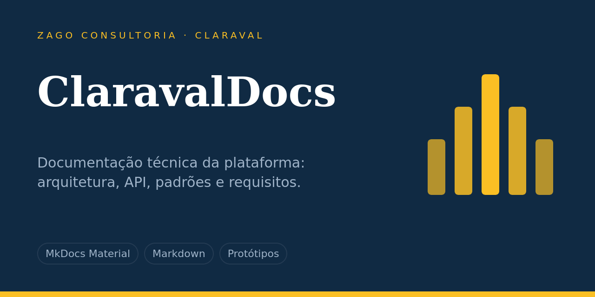

<p align="center">
  
</p>

<p align="center"><b>Documentação técnica da plataforma Claraval: arquitetura, API, padrões, requisitos e protótipos.</b></p>

<p align="center">
  
  
  
</p>

**Sumário:** [Visão geral](#visão-geral) · [Estrutura](#estrutura) · [Começando](#começando) · [Contribuindo](#contribuindo) · [Segurança](#segurança) · [Mantenedores](#mantenedores)

---

## Visão geral

Site de documentação da plataforma, com visão geral dos módulos, arquitetura do backend, do frontend, do banco e da infraestrutura, referência da API por módulo, onboarding, padrões de código, requisitos e protótipos.

## Estrutura

```
docs/api/          referência da API por módulo
docs/arquitetura/  backend, frontend, banco e infraestrutura
docs/onboarding/   setup e glossário
docs/padroes/      padrões de backend, frontend e Git/CI
docs/requisitos/   requisitos, user stories e débito técnico
prototipos/        protótipos HTML
mkdocs.yml         configuração do site
```

## Começando

### Rodar localmente

```bash
python3 -m venv .venv && source .venv/bin/activate
pip install -r requirements.txt
mkdocs serve        # http://127.0.0.1:8000
mkdocs build        # gera o site em site/
```

## Contribuindo

1. Crie uma branch a partir de `main`: `feat/…`, `fix/…`, `docs/…` ou `chore/…`.
2. Use mensagens no padrão [Conventional Commits](https://www.conventionalcommits.org/pt-br/v1.0.0/), por exemplo `feat(auth): adiciona recuperação de senha`.
3. Abra um Pull Request e aguarde revisão e CI verde antes de integrar.
4. Nunca versione chaves, tokens, senhas, certificados ou arquivos `.env`.

## Segurança

Vulnerabilidades e vazamentos devem ser comunicados diretamente à equipe de tecnologia, sem abrir issue pública.

## Mantenedores

Equipe de tecnologia da Zago Consultoria.

Repositório da organização [ZagoConsultoria](https://github.com/ZagoConsultoria). Todos os direitos reservados; não há licença de código aberto definida.
